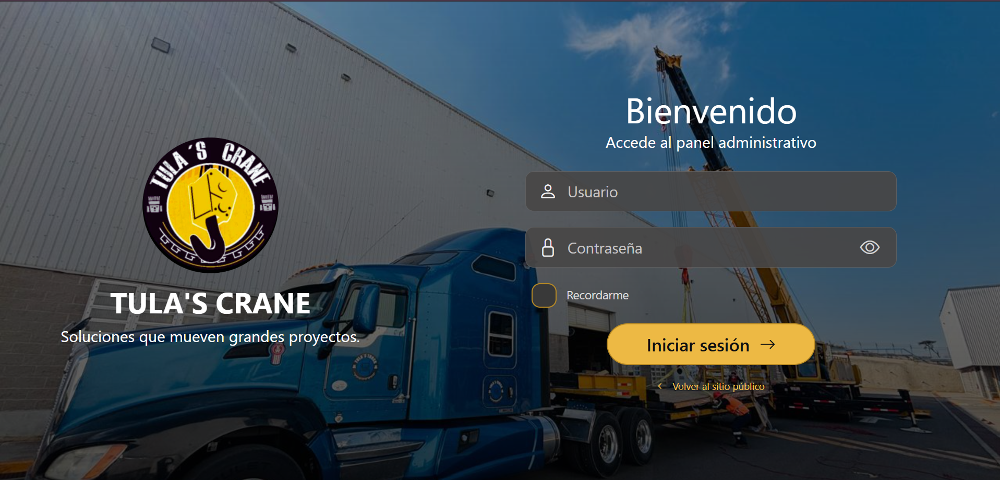
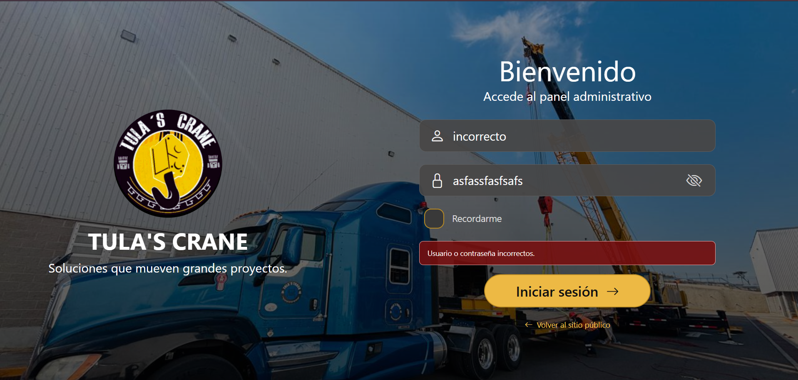
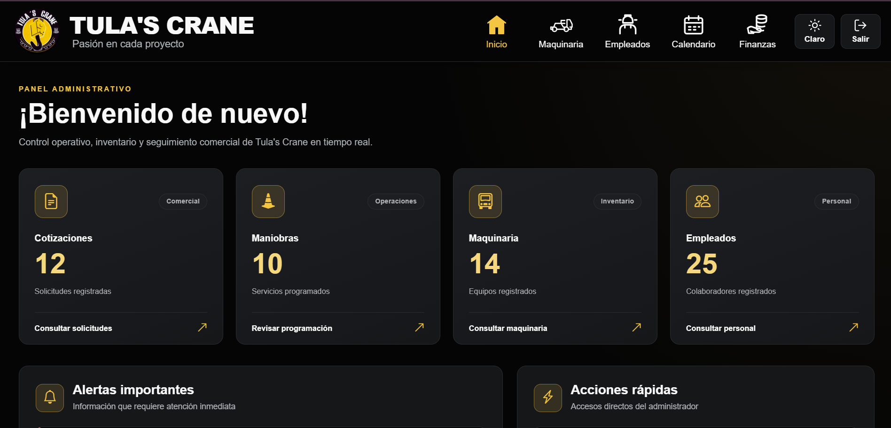
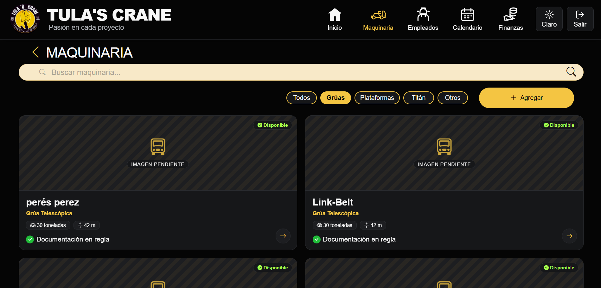
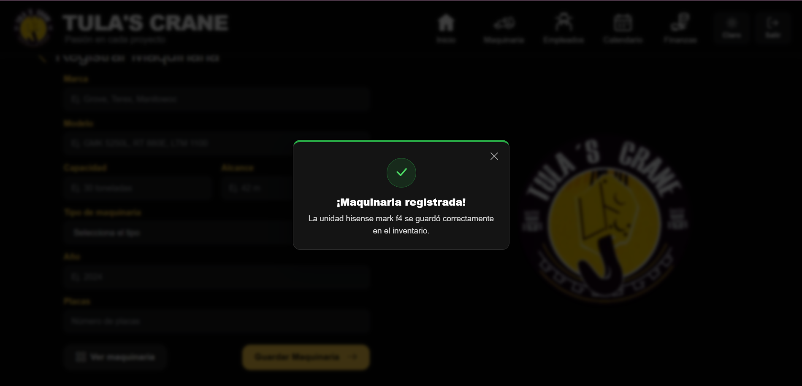
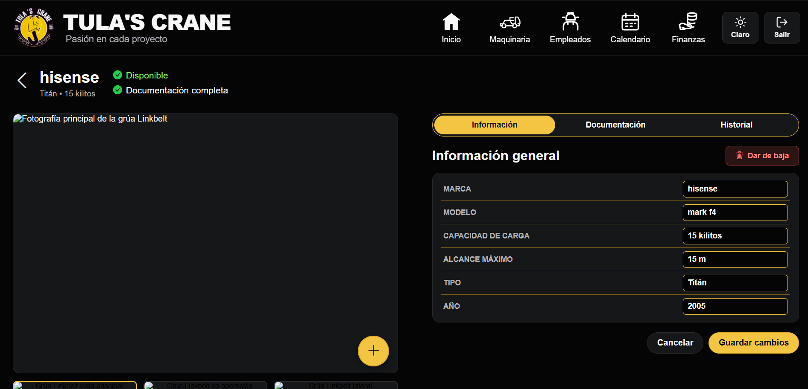
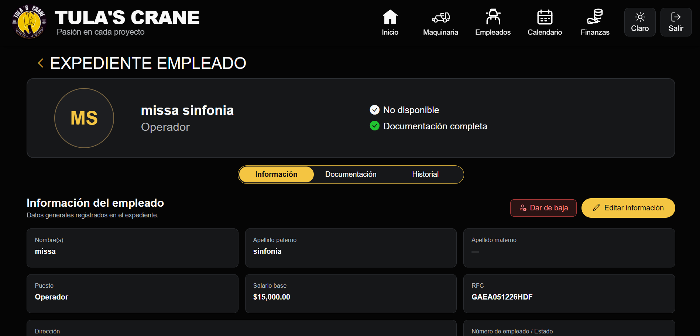
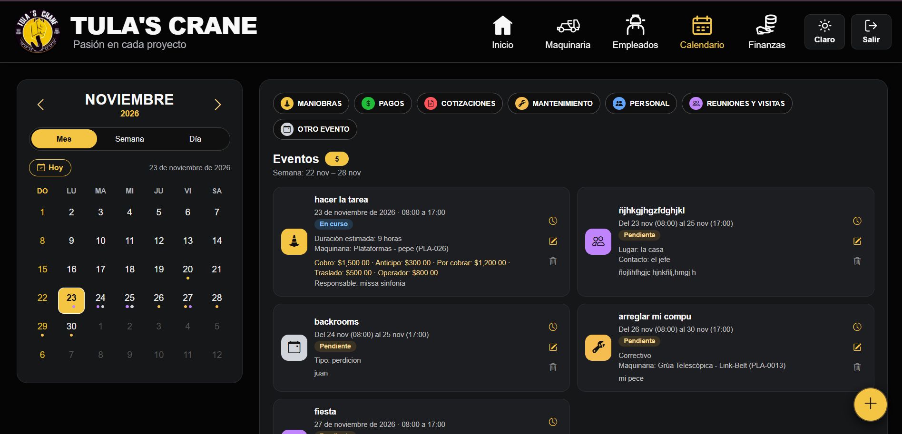
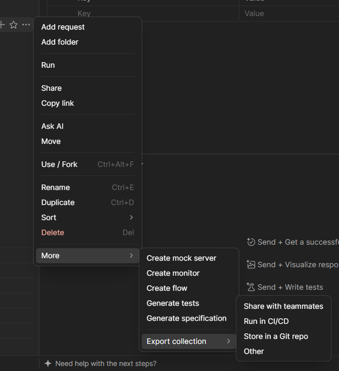
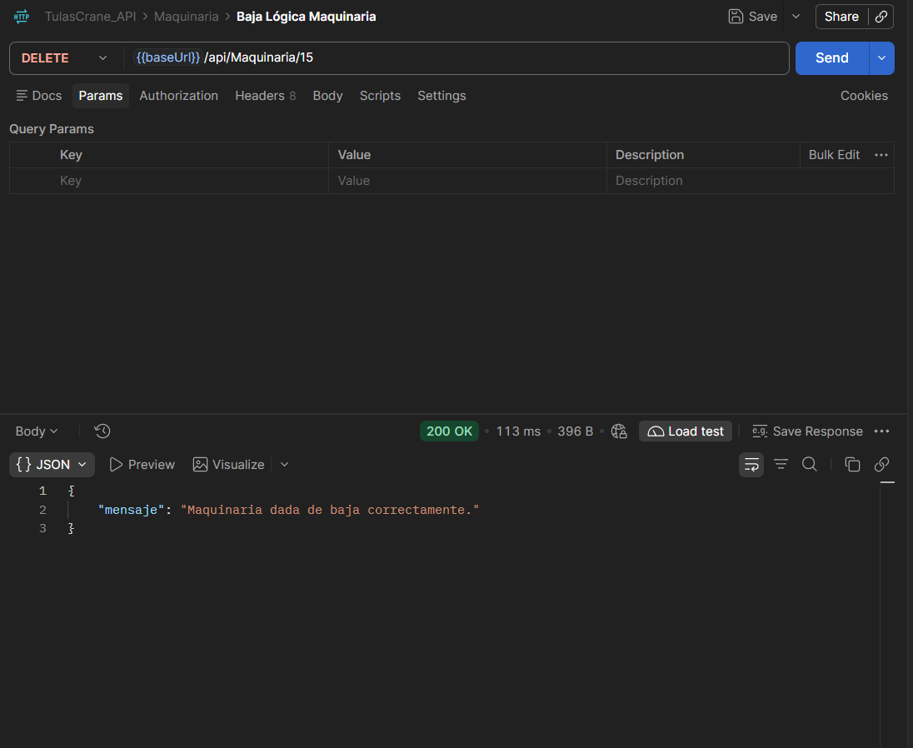

# Sistema de Gestion Operativa y Administrativa - Tula's Crane

Aplicacion web integral (PWA) desarrollada para la administracion operativa de **Tula's Crane**, orientada al control de flota de maquinaria pesada, gestion de expedientes de personal, programacion de maniobras y eventos en calendario, asi como el monitoreo de indicadores clave en tiempo real.

## Estructura del Repositorio

```text
proyecto/
|-- BaseDatos/
|   `-- Scripts.sql               # Creacion de tablas, datos iniciales y Stored Procedures (UTC-6)
|-- API/
|   |-- Controllers/              # Controladores REST (Auth, Dashboard, Maquinaria, Empleados, Calendario)
|   |-- Data/                     # Capa de acceso a datos mediante ADO.NET y Stored Procedures
|   `-- Models/                   # Modelos y DTOs de transferencia de datos
|-- Frontend/
|   |-- css/                      # Hojas de estilo modulares
|   |-- js/                       # Logica de consumo de API (fetch async/await), validaciones y UI
|   |-- IMG/                      # Recursos graficos e identidad visual del sistema
|   |-- index.html                # Pantalla de inicio de sesion (Login)
|   |-- Dashboard.html            # Panel principal con metricas en tiempo real
|   |-- Maquinaria.html           # Catalogo dinamico con busqueda y filtros por categoria
|   |-- RegistrarMaquinaria.html  # Formulario de alta de maquinaria
|   |-- ExpedienteMaquinaria.html # Consulta por ID y edicion de maquinaria
|   |-- Empleados.html            # Catalogo de personal y disponibilidad operativa
|   |-- EmpleadoDetalle.html      # Expediente individual y edicion de empleados
|   `-- Calendario.html           # Agenda operativa de maniobras, mantenimiento y eventos
|-- Postman/
|   `-- Coleccion.json            # Coleccion de pruebas CRUD y eliminacion fisica de la API
|-- docs/
|   `-- capturas/                 # Evidencia visual del sistema en funcionamiento
|-- appsettings.json              # Plantilla de configuracion de la API
|-- MiWebAPI.csproj               # Archivo de proyecto ASP.NET Core 8.0
|-- Program.cs                    # Configuracion de servicios, CORS, archivos estaticos y rutas
`-- README.md                     # Documentacion tecnica del proyecto
```

## Objetivo del Proyecto

Centralizar y digitalizar el control administrativo y operativo de **Tula's Crane** mediante un sistema web conectado a una base de datos relacional en la nube, permitiendo:

* Controlar el acceso administrativo mediante autenticacion y manejo de sesion de usuario.
* Visualizar indicadores operativos en tiempo real (cotizaciones, maniobras, maquinaria y empleados activos).
* Administrar el inventario de gruas, plataformas y unidades con filtros por categoria, consulta individual por ID, registro y actualizacion de especificaciones.
* Gestionar el directorio de operadores y maniobristas con sincronizacion automatica de disponibilidad segun su agenda.
* Programar maniobras y eventos en calendario validando traslapes de horario y permitiendo la gestion completa CRUD (incluyendo eliminacion fisica mediante endpoints dedicados).

## Tecnologias Utilizadas

* **Base de Datos:** Microsoft SQL Server / Azure SQL Database (`T-SQL`, Stored Procedures, Transacciones, ajuste horario local `UTC-6`).
* **Backend (API REST):** C# con **ASP.NET Core 8.0 Web API**, arquitectura en capas (`Controllers`, `Data`, `Models`), **ADO.NET** (`System.Data.SqlClient`), inyeccion de dependencias, politicas CORS y Swagger / OpenAPI.
* **Frontend:** HTML5, CSS3 modular, Bootstrap 5, Bootstrap Icons y JavaScript Vanilla (ES6+ con `Fetch API`, `async/await` y `sessionStorage`).
* **Pruebas y Control de Versiones:** Postman (Coleccion v2.1) y Git / GitHub.

## Requisitos de Ejecucion

1. **.NET 8.0 SDK** instalado en el equipo.
2. **Visual Studio 2022** (con la carga de trabajo *Desarrollo web y de ASP.NET*) o **Visual Studio Code**.
3. **SQL Server** (local o instancia en **Azure SQL Database**) con permisos para crear tablas y procedimientos almacenados.
4. **Postman** (opcional, para importar y ejecutar las pruebas de endpoints).
5. Navegador web moderno (Google Chrome, Microsoft Edge, Firefox).

## Configuracion de la Base de Datos

1. Abre **SQL Server Management Studio (SSMS)** o **Azure Data Studio** y conectate a tu instancia de servidor.
2. Crea una base de datos nueva o selecciona la base de datos de destino.
3. Abre el archivo `BaseDatos/Scripts.sql` y ejecutalo completo para generar:
   * Las tablas relacionales (`admin_usuario`, `datos_maquina`, `empleado`, `maniobra`, `evento_calendario`, `cotizacion`, `dato_servicio`, `factura`, `pago`, `correo`, `telefono`).
   * Los registros iniciales de catalogo y usuario administrador.
   * Todos los procedimientos almacenados (`SP_ADMIN_USUARIO_LOGIN`, `SP_DASHBOARD_RESUMEN`, `SP_OBTENER_MAQUINARIA`, `SP_OBTENER_EXPEDIENTE_MAQUINA`, `SP_CREAR_MAQUINA`, `SP_EDITAR_EXPEDIENTE_MAQUINA`, `SP_ELIMINAR_MAQUINA_PERMANENTE`, `SP_OBTENER_EMPLEADOS`, `SP_OBTENER_EXPEDIENTE_EMPLEADO`, `SP_CREAR_EMPLEADO`, `SP_EDITAR_EXPEDIENTE_EMPLEADO`, `SP_ELIMINAR_EMPLEADO_PERMANENTE`, `SP_OBTENER_EVENTOS_CALENDARIO`, `SP_REGISTRAR_EVENTO_CALENDARIO`, `SP_EDITAR_LAPSO_EVENTO`, `SP_ACTUALIZAR_ESTATUS_EVENTO`, `SP_ELIMINAR_EVENTO_PERMANENTE` y `SP_SINCRONIZAR_DISPONIBILIDAD_OPERATIVA`).

## Configuracion de la Cadena de Conexion

Por seguridad, el repositorio no incluye contrasenas reales. Antes de ejecutar la API, configura tu conexion mediante una de las siguientes dos opciones:

### Opcion A: Mediante User Secrets en Visual Studio (Recomendada)

1. Haz clic derecho sobre el proyecto `MiWebAPI` en el Explorador de Soluciones y selecciona **Administrar secretos de usuario (Manage User Secrets)**.
2. Agrega tu cadena de conexion real en el archivo `secrets.json`:

```json
{
  "ConnectionStrings": {
    "CadenaSQL": "Data Source=TU_SERVIDOR;Initial Catalog=TU_BASE_DE_DATOS;User ID=TU_USUARIO;Password=TU_PASSWORD;TrustServerCertificate=True;"
  }
}
```

### Opcion B: Directamente en `appsettings.json` (solo en entorno local)

Edita el archivo `appsettings.json` en la raiz del proyecto reemplazando los marcadores:

```json
{
  "Logging": {
    "LogLevel": {
      "Default": "Information",
      "Microsoft.AspNetCore": "Warning"
    }
  },
  "AllowedHosts": "*",
  "ConnectionStrings": {
    "CadenaSQL": "Data Source=TU_SERVIDOR;Initial Catalog=TU_BASE_DE_DATOS;User ID=TU_USUARIO;Password=TU_PASSWORD;TrustServerCertificate=True;"
  }
}
```

## Ejecucion de la API y del Frontend

El proyecto esta configurado en `Program.cs` para servir automaticamente los archivos estaticos de la carpeta `Frontend/` desde el mismo servidor de la API, evitando problemas de rutas cruzadas.

1. Abre la solucion `.sln` en **Visual Studio 2022**.
2. Presiona **`Ctrl + F5`** (Iniciar sin depurar) o el boton **Play** para compilar y levantar el servidor.
3. La aplicacion iniciara en `http://localhost:5299` (o el puerto asignado en `Properties/launchSettings.json`):
   * **Frontend (Inicio de sesion):** `http://localhost:5299/index.html`
   * **Documentacion interactiva Swagger API:** `http://localhost:5299/swagger`

## Acceso al Sistema (Credenciales de Prueba)

Por politicas de seguridad del repositorio, las credenciales de acceso no se publican en texto plano en este documento. Para realizar pruebas locales o durante la demostracion presencial:

* Utiliza el usuario administrador registrado en la tabla `[dbo].[admin_usuario]` de tu instancia de base de datos (ver seccion de insercion inicial en `BaseDatos/Scripts.sql`), o solicita las credenciales de demostracion al equipo de desarrollo.

## Pruebas con Postman

1. Abre **Postman** e importa el archivo `Postman/Coleccion.json`.
2. Verifica en la pestana **Variables** de la coleccion que `baseUrl` apunte a tu servidor en ejecucion (por defecto `http://localhost:5299`).
3. Ejecuta los endpoints organizados por modulo:
   * **Auth:** `POST /api/auth/login`
   * **Dashboard:** `GET /api/Dashboard/Resumen`
   * **Maquinaria:** `GET /api/Maquinaria/Catalogo`, `GET /api/Maquinaria/{id}`, `POST /api/Maquinaria/Registrar`, `PUT /api/Maquinaria/{id}`, `DELETE /api/Maquinaria/Permanente/{id}`
   * **Empleados:** `GET /api/Empleados/Catalogo`, `GET /api/Empleados/{id}`, `POST /api/Empleados/Registrar`, `PUT /api/Empleados/{id}`, `DELETE /api/Empleados/Permanente/{id}`
   * **Calendario:** `GET /api/Calendario/Eventos`, `POST /api/Calendario/Registrar`, `PUT /api/Calendario/Estatus`, `DELETE /api/Calendario/Permanente/{tipo}/{idNumerico}`

## Integrantes del Equipo

* **[Nombre Completo Integrante 1]** - Desarrollo Backend / Base de Datos
* **[Nombre Completo Integrante 2]** - Desarrollo Frontend / Integracion API
* **[Nombre Completo Integrante 3]** - Diseno UI/UX / Pruebas y Documentacion

## Capturas del Sistema

### 1. Inicio de Sesion y Validaciones

| Pantalla de Login | Validacion de Acceso |
| :---: | :---: |
|  |  |

### 2. Panel Principal (Dashboard) y Sesion Activa



### 3. Modulo de Maquinaria (Catalogo con Filtros, Alta y Edicion por ID)

| Catalogo y Filtros por Categoria | Registro de Maquinaria y Mensajes |
| :---: | :---: |
|  |  |



### 4. Modulo de Empleados y Agenda Operativa (Calendario)

| Gestion de Personal | Calendario de Maniobras y Eventos |
| :---: | :---: |
|  |  |

### 5. Pruebas de API y Eliminacion Fisica en Postman

| Pruebas CRUD en Postman | Eliminacion Fisica (`DELETE`) |
| :---: | :---: |
|  |  |